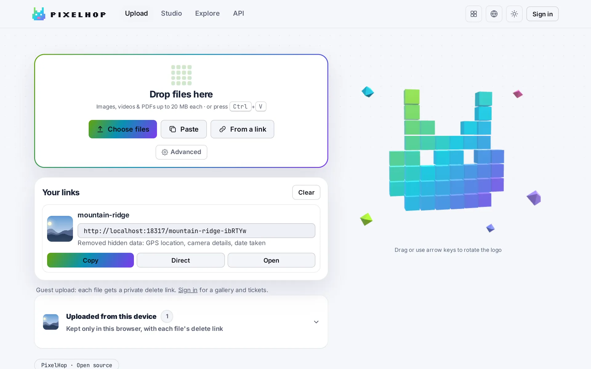
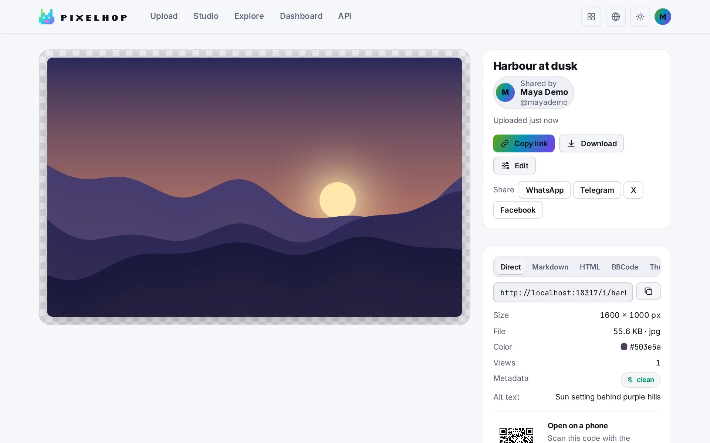
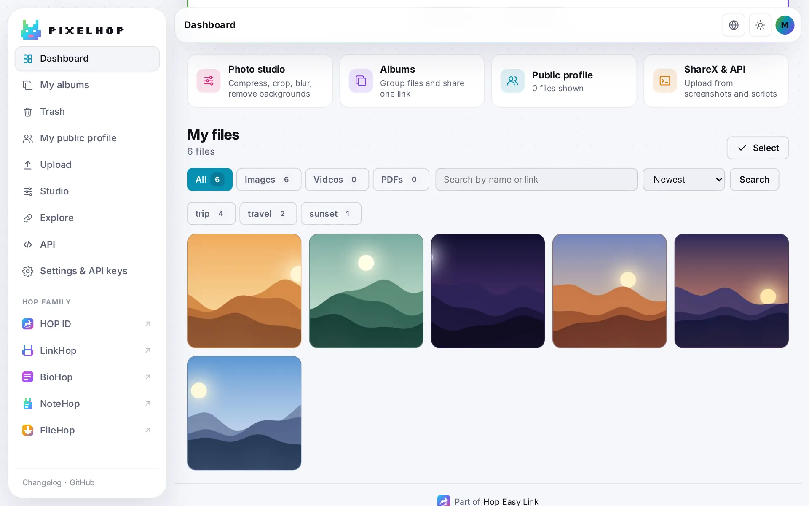
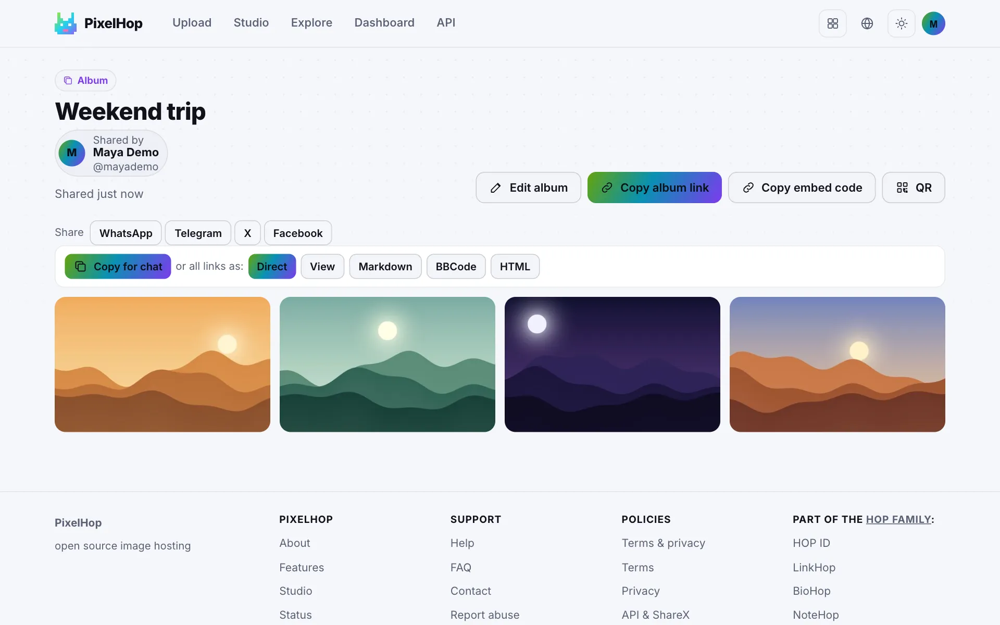
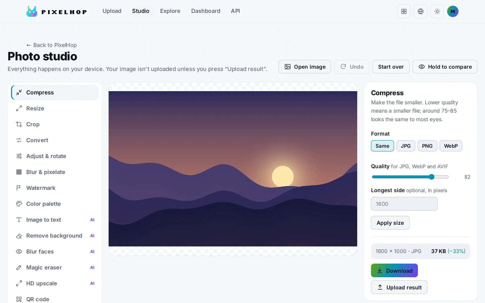

<p align="center">🌐 <a href="README.md">English</a> · <a href="README.zh-CN.md">简体中文</a> · <a href="README.de.md">Deutsch</a> · <a href="README.id.md">Bahasa Indonesia</a> · <a href="README.ja.md">日本語</a> · <a href="README.pt-BR.md">Português (Brasil)</a> · <a href="README.es.md">Español</a> · <b>Français</b> · <a href="README.ru.md">Русский</a></p>

# PixelHop

Hébergement d'images open source dans un seul programme Go. Il retire la position GPS et les informations d'appareil des photos avant que quiconque les voie, et son studio photo fonctionne dans le navigateur : la photo reste donc sur votre appareil jusqu'à ce que vous la téléversiez.

En ligne sur [pixel.hel.ink](https://pixel.hel.ink). Les liens courts utilisent [p.hel.ink](https://p.hel.ink).

<p align="center">
  <a href="https://pixel.hel.ink"><b>Essayer pixel.hel.ink</b></a> ·
  <a href="https://navi-crwn.github.io/PixelHop/">Site web</a> ·
  <a href="#install">Installation</a> ·
  <a href="#api">API</a> ·
  <a href="#upgrading">Passer de la v2</a> ·
  <a href="CHANGELOG.md">Journal des modifications</a> ·
  <a href="SECURITY.md">Sécurité</a>
</p>

<p align="center">
  
  
  
  
  
</p>

<p align="center"><picture><source media="(prefers-color-scheme: dark)" srcset="docs/readme/home-dark.webp"></picture></p>

## Ce qu'il fait

- Il reçoit images, vidéos et PDF par glisser-déposer, collage, sélection de fichier ou lien, et donne à chaque fichier un lien court et lisible, comme `beach-sunset-x7Kp2Q`.
- Il retire les métadonnées cachées des photos et des vidéos (ce qui se passe exactement pour chaque type de fichier est détaillé dans [Ce qui est retiré](#what-gets-removed)).
- Il regroupe plusieurs fichiers dans un album avec un seul lien.
- Il comprend un studio photo qui compresse, redimensionne, recadre, convertit, floute, lit le texte et supprime les arrière-plans dans le navigateur.
- Il tourne comme un seul fichier statique, avec SQLite intégré. Ni PHP, ni Python, ni MySQL, ni cron ne sont nécessaires. Les images sont stockées sur disque ou dans n'importe quel bucket compatible S3.

Il convient à ceux qui partagent des captures d'écran et des photos sur des messageries, des forums ou GitHub, à ceux qui veulent une destination [ShareX](https://getsharex.com) qu'ils contrôlent, et à ceux qui se soucient de ce qu'une photo révèle.

## Captures d'écran

<p align="center"><picture><source media="(prefers-color-scheme: dark)" srcset="docs/readme/image-dark.webp"></picture></p>

<p align="center"><picture><source media="(prefers-color-scheme: dark)" srcset="docs/readme/dashboard-dark.webp"></picture></p>

<p align="center"><picture><source media="(prefers-color-scheme: dark)" srcset="docs/readme/album-dark.webp"></picture></p>

<p align="center"><picture><source media="(prefers-color-scheme: dark)" srcset="docs/readme/studio-dark.webp"></picture></p>

Ces captures viennent d'une instance de démonstration locale avec des images générées. [`scripts/readme-images.mjs`](scripts/readme-images.mjs) permet de les recréer.

<a id="install"></a>

## Installation

Le script d'installation vérifie votre ordinateur, pose quelques questions et compile PixelHop depuis les sources. Il faut Go 1.27 ou plus récent, ou Docker.

```bash
curl -fsSL https://raw.githubusercontent.com/navi-crwn/PixelHop/main/install.sh | bash
```

Depuis un clone, lancez `./install.sh`. Plus tard, `./update.sh` récupère la nouvelle version, copie la base de données dans `backups/` et recompile, et `./uninstall.sh` supprime le programme mais garde vos données, sauf si vous ajoutez `--purge`. Chaque script accepte `--yes` (accepter toutes les valeurs par défaut), `--dry-run` (afficher les étapes sans les exécuter) et `--help`. Le script d'installation peut lancer PixelHop au premier plan, écrire une unité systemd ou un fichier Docker Compose, et, si vous le souhaitez, installer à côté un hub [HOP ID](https://github.com/navi-crwn/HEL.ink).

Vous pouvez aussi installer à la main.

**Binaire** (Linux, macOS et Windows, amd64 et arm64, sur la page [Releases](../../releases)) :

```bash
curl -L -o pixelhop https://github.com/navi-crwn/pixelhop/releases/latest/download/pixelhop-linux-amd64
chmod +x pixelhop
PIXELHOP_BASE_URL=https://img.example.com ./pixelhop
```

**Docker :**

```bash
docker run -d --name pixelhop -p 8080:8080 \
  -e PIXELHOP_BASE_URL=https://img.example.com \
  -v pixelhop:/data ghcr.io/navi-crwn/pixelhop:latest
```

L'image s'exécute avec l'utilisateur non root 65532 : le volume de données doit donc être accessible en écriture à cet utilisateur. Le dépôt contient aussi un [`docker-compose.yml`](docker-compose.yml) qui lit un fichier `.env` (copiez `.env.example`) et garde les données dans `./data`.

**Depuis les sources** (Go 1.27 ou plus récent) :

```bash
git clone https://github.com/navi-crwn/pixelhop.git && cd pixelhop
make build && ./pixelhop
```

Ouvrez `http://localhost:8080` et créez un compte. Le premier compte devient administrateur. Vous pouvez aussi en créer un en ligne de commande : `pixelhop user add vous@example.com --admin`.

Les vidéos et les PDF ne sont traités que si `ffmpeg`, `ffprobe` et Ghostscript (`gs`) sont installés sur le serveur. Sans eux, ces fichiers sont conservés tels qu'ils ont été envoyés. L'image Docker n'en contient aucun : installez-les sur l'hôte ou construisez votre propre image si vous hébergez des vidéos ou des PDF. Les photos HEIC et AVIF, la sortie WebP et AVIF de l'URL de redimensionnement et les outils du studio côté serveur demandent le [`tools/ai-server.py`](tools/ai-server.py) facultatif.

<a id="what-gets-removed"></a>

## Ce qui est retiré

PixelHop travaille sur la structure du fichier et copie telles quelles les données d'image compressées, la qualité reste donc identique.

| Fichier | Ce qui se passe |
|---|---|
| JPEG | L'EXIF (GPS, marque et modèle de l'appareil, numéros de série, date de prise de vue), le XMP, l'IPTC et les commentaires sont retirés. Le profil colorimétrique et les autres segments sont conservés. Une photo dont l'EXIF indique une rotation est redressée puis enregistrée de nouveau en JPEG avec la qualité 92, sans profil colorimétrique. C'est le seul cas où les pixels sont réencodés. |
| PNG | Les blocs de texte, le bloc EXIF et l'heure de modification sont retirés. Le profil colorimétrique est conservé. |
| WebP | L'EXIF et le XMP sont retirés des fichiers étendus. Les fichiers WebP simples ne portent pas de métadonnées. |
| GIF | Conservé tel qu'il a été envoyé. Rien n'est retiré. |
| BMP | Converti en PNG. |
| HEIC, AVIF | Si le service d'IA est configuré, converti en JPEG ou PNG redressé et sans métadonnées. Sinon, le téléversement est refusé. |
| Vidéo (MP4, MOV, 3GP, WebM, MKV) | Avec `ffmpeg` installé, la position, les dates, l'appareil et les balises de l'encodeur sont retirés sans réencodage. Seules la première piste vidéo et la première piste audio sont conservées. Ensuite, une tâche en arrière-plan réduit la vidéo en H.264 et AAC, avec 1280 px au maximum sur le grand côté et 30 images par seconde. Sans `ffmpeg`, le fichier est conservé tel qu'il a été envoyé. |
| PDF | Avec Ghostscript installé, le fichier est réécrit pour être plus léger, et la copie plus petite est conservée si elle fait gagner au moins 10 %. Les propriétés du document, comme le titre et l'auteur, ne sont pas retirées. Sans Ghostscript, le fichier est conservé tel qu'il a été envoyé. |

Après un téléversement, la page indique quels types de données ont été retirés. La vérification se fait par type (position GPS, informations d'appareil, date de prise de vue, logiciel de retouche, XMP, IPTC, commentaire, texte intégré). Les valeurs elles-mêmes ne sont jamais lues.

## Fonctionnalités

Partage :
- Chaque fichier a un lien direct, un lien de page, du Markdown, du HTML, du BBCode et un code QR, ainsi que des balises Open Graph pour que les aperçus s'affichent bien dans Discord, X et WhatsApp.
- Des albums à partir de plusieurs fichiers, avec un titre, une description, une couverture et un ordre modifiables ensuite. Un album peut être intégré à un autre site avec une iframe (`/a/{id}/embed`).
- Copiez en un clic tous les liens d'un album ou d'un téléversement groupé, dans un format.
- Expiration après 10 minutes, 1 heure, 1 jour, 7 jours, 30 jours ou 90 jours.
- Chaque fichier est non répertorié (par défaut), visible par vous seul, ou protégé par un mot de passe. Un fichier peut porter un avertissement de contenu (sensible ou adulte) ; les visiteurs confirment avant de le voir. Les propriétaires peuvent refuser que leurs images soient intégrées à d'autres sites.
- Étiquettes, recherche et filtre par étiquette dans le tableau de bord. Les fichiers supprimés restent 7 jours dans la corbeille.
- Les vues par jour et les sites qui renvoient vers un fichier. Les référents ne sont conservés que par nom d'hôte.
- Des copies redimensionnées à la demande, par exemple `/i/photo.jpg?w=800`, créées une fois puis mises en cache.
- Des profils publics sur `/u/username`, un fil Explorer avec les fichiers que les gens ont choisi d'afficher, oEmbed et un plan du site.

Comptes :
- Les invités peuvent téléverser (jusqu'à 20 Mo par fichier, 25 fichiers par jour et par adresse et 10 images par album par défaut) et reçoivent pour chaque fichier un lien de suppression privé, que le navigateur retient aussi.
- Les membres ont une galerie avec recherche, tri, renommage et actions groupées, un quota de stockage (128 Mo par défaut), une carte de premiers pas et un export ZIP de tout ce qu'ils ont téléversé.
- Les paramètres montrent où vous êtes connecté, vous déconnectent partout ailleurs et gèrent les clés d'API, les webhooks, votre profil et la suppression du compte.
- Connexion par e-mail et mot de passe, par Google ou avec un compte HEL.ink (le hub HOP ID), le tout facultatif. Sans `HELINK_URL`, PixelHop ne contacte jamais HEL.ink. Cloudflare Turnstile peut protéger les formulaires de connexion et d'inscription.

Studio :
- Dans le navigateur : compresser, redimensionner, recadrer, convertir (JPG, PNG, WebP, et AVIF là où le navigateur sait l'encoder), ajuster et pivoter, flouter et pixelliser, filigrane, palette de couleurs, code QR, texte à partir d'images (OCR, 30 langues, jusqu'à cinq à la fois) et suppression de l'arrière-plan. Rien n'est téléversé tant que vous n'appuyez pas sur Téléverser le résultat.
- Lot : redimensionner, convertir, ajouter un filigrane ou lancer les étapes d'IA sur un ensemble d'images, puis télécharger un ZIP ou téléverser un album.
- Sur le serveur, pour les utilisateurs connectés, si vous faites tourner `tools/ai-server.py` : suppression de l'arrière-plan, floutage automatique des visages, gomme magique et agrandissement 2x. Une image à la fois, avec une limite quotidienne, et rien n'est conservé.

Pour les développeurs :
- Une API REST avec des clés bearer. Une clé peut être limitée au seul téléversement.
- Un fichier de configuration ShareX généré dans les paramètres ; les configurations ShareX de PixelHop 2 continuent de fonctionner.
- Des webhooks pour `image.uploaded` et `image.deleted`, signés en HMAC-SHA256 dans l'en-tête `X-PixelHop-Signature`.
- Un téléverseur en ligne de commande dans le même programme : `pixelhop push *.png --format markdown`.
- Une [description OpenAPI](web/static/openapi.json) servie sur `/static/openapi.json`, et `/healthz`, `/metrics` et `/status` pour la supervision.
- Installable comme application sur téléphone, avec une cible de partage pour les photos, vidéos et PDF.

Exploitation :
- Un seul binaire statique, une image Docker ou une unité systemd. Stockez les fichiers sur disque ou sur un stockage compatible S3 (AWS S3, Cloudflare R2, MinIO, Backblaze B2, Wasabi, Contabo).
- Les téléversements se mettent en pause d'eux-mêmes quand l'espace disque libre devient faible, et `PIXELHOP_READ_ONLY=true` les met en pause pour maintenance. Les fichiers déjà en ligne continuent de fonctionner. Voir [docs/UPLOAD-STORAGE.md](docs/UPLOAD-STORAGE.md).
- L'interface existe en neuf langues : English, 简体中文, Deutsch, Bahasa Indonesia, 日本語, Português (Brasil), Español, Français et Русский. Utilisez `?lang=de` pour changer ; le choix est gardé dans un cookie, et le réglage de langue du navigateur n'est pas utilisé.
- Les liens partagés peuvent se trouver sur un autre hôte que l'application (`PIXELHOP_LINK_URL`). Sur pixel.hel.ink, l'application est sur pixel.hel.ink et les liens restent `p.hel.ink/...`.

Sécurité :
- Les mots de passe utilisent Argon2id. Les clés d'API et les jetons de session sont stockés sous forme de hachages.
- Les formulaires sont protégés contre les envois intersites, et une Content Security Policy stricte est envoyée.
- « Téléverser depuis un lien » vérifie l'adresse résolue de chaque connexion et ne peut donc pas être dirigé vers des réseaux privés. Les images très grandes sont refusées d'après leur en-tête, avant d'être décodées. Les téléversements sont limités en fréquence, et l'IP du client n'est prise que chez les proxys que vous indiquez.
- Les fichiers retirés par les modérateurs ne peuvent pas être renvoyés, car leur SHA-256 est mémorisé.
- Comment un téléversement est traité et comment le serveur reste stable sous charge : [docs/ARCHITECTURE.md](docs/ARCHITECTURE.md). L'histoire derrière la version 3 : [AUDIT.md](AUDIT.md). Pour signaler une vulnérabilité, lisez [SECURITY.md](SECURITY.md).

Modération : les pages d'administration intégrées ont été retirées dans la 3.7.0. Chaque page a un bouton Signaler. La file des signalements, le masquage et la suppression de contenu, les blocages d'IP, les actions sur les comptes, les réglages à chaud et le bandeau d'annonce relèvent du centre de contrôle HOP, qui parle à PixelHop par l'API signée `/hop/*` (le HOP App Protocol). Il s'utilise avec la connexion HEL.ink, est signé avec `HELINK_SSO_SECRET`, et les appelants autorisés sont listés dans `HOP_ADMIN_CLIENTS` (par défaut `imperium,helink`). Chaque modification faite ainsi est enregistrée dans la table `hop_audit`. Le centre de contrôle lui-même est privé au projet HOP. Une installation autonome a le bouton Signaler, les commandes `pixelhop user` (`add`, `passwd`, `admin`, `merge`) et les droits supplémentaires du rôle administrateur via l'API, mais pas d'écran pour la file des signalements.

## Paramètres

Les paramètres sont des variables d'environnement, toutes facultatives. [`.env.example`](.env.example) liste les plus courantes avec leurs valeurs par défaut ; les autres sont lues dans [`internal/config/config.go`](internal/config/config.go). Le tableau présente celles que vous êtes le plus susceptible de changer. La liste complète se trouve dans le [README](README.md) en anglais.

| Variable | Par défaut | Rôle |
|---|---|---|
| `PIXELHOP_BASE_URL` | `http://localhost:8080` | Adresse publique de l'application (connexion, téléversement, tableau de bord). Utilisez `https://` en production, ce qui active aussi les cookies sécurisés |
| `PIXELHOP_LINK_URL` | `PIXELHOP_BASE_URL` | Un autre hôte pour les liens partagés (pages d'images et d'albums, fichiers directs). Ce doit être un hôte différent, qui doit aussi atteindre PixelHop |
| `PIXELHOP_DATA` | `./data` | Base de données et, avec le stockage local, les images |
| `PIXELHOP_MAX_UPLOAD_MB` | `20` | Par image |
| `PIXELHOP_MAX_MEDIA_MB` | `100` | Par vidéo ou PDF, pour les membres connectés |
| `PIXELHOP_GUEST_MAX_MB` | `20` | Par fichier de tout type, pour les invités |
| `PIXELHOP_GUEST_UPLOADS` | `true` | Autoriser les téléversements sans compte |
| `PIXELHOP_GUEST_ALBUM_MAX` | `10` | Images dans un album créé par un invité (0 = sans limite) ; réglable aussi dans le centre de contrôle |
| `PIXELHOP_GUEST_DAILY_MAX` | `25` | Fichiers qu'une adresse invitée peut envoyer par 24 heures (0 = sans limite) ; réglable aussi dans le centre de contrôle |
| `PIXELHOP_GUEST_TTL_DAYS` | `30` | Jours pendant lesquels un nouvel envoi invité reste en ligne (0 = jusqu'à suppression) ; les fichiers existants ne changent pas ; réglable aussi dans le centre de contrôle |
| `PIXELHOP_DEFAULT_QUOTA_MB` | `128` | Stockage de chaque nouveau compte ; les comptes existants gardent le leur |
| `PIXELHOP_REGISTRATION` | `true` | Autoriser les nouveaux comptes |
| `PIXELHOP_READ_ONLY` | `false` | Mettre les téléversements en pause pour maintenance |
| `PIXELHOP_TRUSTED_PROXIES` | - | `cloudflare`, ou les IP ou CIDR de votre proxy inverse |
| `PIXELHOP_STORAGE`, `S3_ENDPOINT`, `S3_BUCKET`, `S3_ACCESS_KEY`, `S3_SECRET_KEY` | `local` | `local` ou `s3` ; le stockage S3 a besoin des quatre autres |
| `GOOGLE_CLIENT_ID`, `GOOGLE_CLIENT_SECRET` | - | Connexion avec Google |
| `HELINK_URL`, `HELINK_SSO_SECRET` | - | Connexion avec un compte HEL.ink. Le secret fait au moins 32 caractères et est identique à `PIXELHOP_SSO_SECRET` dans le `.env` de HEL.ink |
| `PIXELHOP_CONTROL_URL` | - | Adresse du centre de contrôle HOP ; les administrateurs qui ouvrent `/admin` y sont envoyés |
| `TURNSTILE_SITE_KEY`, `TURNSTILE_SECRET_KEY` | - | Cloudflare Turnstile sur la connexion et l'inscription. Avec les comptes HEL.ink activés, ces formulaires refusent toute tentative sans les clés |
| `PIXELHOP_REMBG_URL` | - | Adresse de `tools/ai-server.py`, par exemple `http://127.0.0.1:7001` |

Le secret HEL.ink peut aussi s'appeler `HOP_SSO_SECRET_PIXELHOP` ou `HOP_SSO_SECRET`. Pendant une rotation, l'ancien secret reste accepté via `HELINK_SSO_SECRET_PREV` (ou `HOP_SSO_SECRET_PREV`).

### Proxy inverse, service et sauvegardes

- [`deploy/nginx.conf`](deploy/nginx.conf) est un exemple de proxy inverse. Définissez `PIXELHOP_TRUSTED_PROXIES=127.0.0.1` pour que PixelHop fasse confiance au `X-Forwarded-For` de nginx, et ajoutez `cloudflare` si Cloudflare est devant.
- [`deploy/pixelhop.service`](deploy/pixelhop.service) est une unité systemd durcie. [`deploy/pixelhop-ai.service`](deploy/pixelhop-ai.service) lance le service d'IA facultatif, qui demande `rembg`, `opencv-python-headless` et `onnxruntime` (voir l'en-tête de [`tools/ai-server.py`](tools/ai-server.py)).
- Pour sauvegarder, copiez le dossier de données, ou lancez `sqlite3 data/pixelhop.db ".backup copy.db"` pendant que PixelHop tourne. `./update.sh` fait une telle copie dans `backups/` avant chaque mise à jour.

## Utilisation

1. Ouvrez le site, puis déposez, collez (<kbd>Ctrl</kbd>+<kbd>V</kbd>) ou indiquez le lien d'une image.
2. Facultatif : choisissez Supprimer après, et si le nom du fichier figure dans le lien.
3. Le lien est copié pour vous. Ouvrez-le pour obtenir le lien direct, les codes d'intégration et le code QR.

Appuyez sur `?` sur n'importe quelle page pour voir les raccourcis clavier.

**ShareX.** Allez dans Paramètres, Clés d'API, créez une clé, puis appuyez sur Télécharger la configuration ShareX avec cette clé et ouvrez le fichier.

**Ligne de commande.** Le même programme `pixelhop` téléverse vers n'importe quel serveur PixelHop. `pixelhop login` garde l'adresse et la clé dans `~/.config/pixelhop/client.json` ; `PIXELHOP_SERVER` et `PIXELHOP_KEY` ont priorité.

```bash
pixelhop login --server https://pixel.hel.ink --key ph_yourkey
pixelhop push screenshot.png photos/*.jpg --expire 7d --format markdown
```

**Téléphone.** Ouvrez le site et choisissez Ajouter à l'écran d'accueil. PixelHop apparaît ensuite dans le menu de partage.

<a id="api"></a>

## API

```bash
curl -H "Authorization: Bearer ph_yourkey" -F "file=@holiday.jpg" https://pixel.hel.ink/api/v1/upload
```

| Point d'accès | Rôle |
|---|---|
| `POST /api/v1/upload` | Téléverse des fichiers (`file`, répétable) ou des liens (`url`). Options : `expire` (`10m`, `1h`, `1d`, `7d`, `30d`, `90d`), `slug` (`0` garde le nom du fichier hors du lien), `title`, `alt`, `album_id`, `album` (`force` ou `0`), `listed`, `content_warning` (`sensitive` ou `adult`), `warning_reason` |
| `POST /api/v1/uploads`, `PUT /api/v1/uploads/{id}`, `POST /api/v1/uploads/{id}/finish` | Téléverse un gros fichier en morceaux de 8 Mo |
| `GET /api/v1/images` | Vos images (`page`, `limit`, `q`, `sort`) |
| `GET`, `PATCH`, `DELETE /api/v1/images/{id}` | Lit, modifie ou supprime une image. `PATCH` accepte `title`, `alt`, `listed`, `visibility` (`unlisted`, `private`, ou `password` avec `password`), `tags`, `content_warning` et `warning_reason`. `DELETE` met votre propre fichier à la corbeille ; ajoutez `?permanent=1` pour le supprimer définitivement |
| `POST /api/v1/images/{id}/restore` | Ramène un fichier de la corbeille |
| `GET /api/v1/images/{id}/stats` | Vues par jour et sites référents |
| `GET`, `POST /api/v1/albums` / `GET`, `PATCH`, `DELETE /api/v1/albums/{id}` | Liste, crée, lit, modifie et supprime des albums |
| `GET /api/v1/users/{username}/images` | Public : les images du profil de quelqu'un |
| `GET /api/v1/me` | Votre compte et l'espace utilisé |
| `GET /api/v1/me/media` | Vos propres images (`type=image`) ou PDF (`type=pdf`) qu'une autre page peut afficher : sans fichiers privés, protégés par mot de passe, à expiration ou avec avertissement de contenu (`cursor`, `limit`). Ouvert aussi aux apps HOP nommées dans `PIXELHOP_MEDIA_CLIENTS` (le sélecteur de médias de BioHop), signé de serveur à serveur pour un membre |
| `GET /api/v1/stats` | Totaux publics et version du serveur |
| `GET /api/v1/upload-status` | Si les téléversements sont acceptés en ce moment |
| `POST /api/v1/tools/{remove-background,faces,erase,upscale}` | Outils d'IA du serveur (connecté ; `file`, plus `mask` pour erase) |
| `GET /i/{id}.jpg?w=&h=&fit=&format=&q=` | Copies redimensionnées, créées une fois puis mises en cache. `format=webp` et `avif` demandent le service d'IA |
| `GET /oembed?url=...` | oEmbed pour les pages d'images |
| `GET /tools/qr.png`, `/tools/qr.svg` | Code QR pour `text` (`size`, `level`, `fg`, `bg`) |

Chaque réponse a la forme `{"success": true, "data": ...}` ou `{"success": false, "error": "..."}`. La référence complète se trouve sur [`/docs`](https://pixel.hel.ink/docs) de n'importe quel serveur PixelHop.

<a id="upgrading"></a>

## Passer de PixelHop 2

PixelHop 2 était une application PHP avec MySQL, un venv Python et des tâches cron. Son code reste dans l'étiquette [`v2.3.0-php`](../../tree/v2.3.0-php). Une seule commande reprend les données :

```bash
pixelhop import --images /var/www/pichost/data/images.json \
  --mysql "user:pass@tcp(127.0.0.1:3306)/pixelhop" --copy
```

- Les utilisateurs gardent leurs identifiants, rôles, quotas et mots de passe. Les hachages argon2id de PHP sont vérifiés et mis à niveau à la prochaine connexion. Les comptes Google restent liés.
- Les images gardent leurs identifiants. Avec `--copy`, elles sont téléchargées dans le stockage de PixelHop 3 avec de nouvelles miniatures ; sans cette option, elles continuent d'être servies depuis les anciens buckets.
- Les anciens liens continuent de fonctionner : `/{id}`, `/i/2026/08/27/{id}_original.webp`, `/auth/google-callback` (définissez `GOOGLE_REDIRECT_URI`) et les configurations ShareX qui envoient vers `/api/upload.php`.

[AUDIT.md](AUDIT.md) explique pourquoi il a été réécrit.

## Développement

```
cmd/pixelhop/     la commande : serve, user, import, push, login
internal/app/     serveur web : pages, API, téléversements, modération, HOP App Protocol
internal/db/      schéma SQLite, migrations et requêtes
internal/imaging/ détection du type, retrait des métadonnées, miniatures
internal/storage/ disque local, S3 (signataire SigV4 maison), anciennes URL
internal/netsafe/ récupération à l'épreuve du SSRF pour « Téléverser depuis un lien »
web/              modèles, scripts et fichiers des neuf langues, intégrés au binaire
docs/             le site GitHub Pages et les images du README
scripts/          scripts d'aide (images du README, données du journal des modifications, vérification de la famille HOP)
tools/            le service d'IA facultatif
deploy/           exemples nginx et systemd
```

`make test` lance `go vet` et les tests, et `make build` produit `./pixelhop`. `scripts/readme-images.mjs` refait les captures du README à partir d'une instance en marche (voir le commentaire en tête du fichier). `python3 scripts/build-changelog.py --repo PixelHop` régénère `web/changelog.json`, les données de la page `/changelog`, à partir des pull requests fusionnées ; il faut un `gh` authentifié.

## FAQ

<details><summary>Le studio est-il vraiment privé ?</summary>

L'édition se fait sur votre appareil avec Canvas et WebAssembly. La première fois que vous utilisez la reconnaissance de texte ou la suppression d'arrière-plan, le navigateur télécharge [tesseract.js](https://github.com/naptha/tesseract.js) et [@imgly/background-removal](https://github.com/imgly/background-removal-js) depuis jsDelivr, ainsi que leurs données de langue et leurs modèles depuis tessdata.projectnaptha.com et staticimgly.com. Votre image n'est envoyée nulle part tant que vous n'appuyez pas sur Téléverser le résultat. Un serveur auto-hébergé qui impose une Content Security Policy plus stricte doit autoriser ces adresses.
</details>

<details><summary>Puis-je désactiver les téléversements d'invités ou les inscriptions ?</summary>

Oui. Définissez `PIXELHOP_GUEST_UPLOADS=false` ou `PIXELHOP_REGISTRATION=false`. Avec le centre de contrôle HOP, vous pouvez aussi changer les deux pendant que le serveur tourne.
</details>

<details><summary>De quelles ressources a-t-il besoin ?</summary>

Un petit serveur suffit. Un processus `pixelhop` fraîchement lancé a utilisé environ 16 Mo de mémoire lors d'un test sous macOS, et les binaires des versions font de 16 à 17 Mo. Les grandes images sont décodées quelques-unes à la fois : une rafale de téléversements ne peut donc pas épuiser la mémoire.
</details>

## Auto-hébergement

<!-- self-hosting:start -->
Tout ce dont PixelHop a besoin se trouve dans des dépôts publics : aucun dépôt privé, aucun jeton et aucun compte hel.ink. Les détails sont dans le guide de la famille : [docs/self-hosting.md](https://github.com/navi-crwn/HEL.ink/blob/main/docs/self-hosting.md) (en anglais).

| Élément | Pour PixelHop | Rôle |
| --- | --- | --- |
| [HEL.ink](https://github.com/navi-crwn/HEL.ink) (hub, HOP ID) | Facultatif : ajoute « Se connecter avec HOP ID » | Comptes et connexion pour toutes les apps |
| [Imperium](https://github.com/navi-crwn/Imperium) | Facultatif, mais les pages d'administration de PixelHop s'y trouvent | Panneau d'administration de toute la famille ; nécessite le hub |
| Polices et tuiles de la famille | Rien à installer : chargés depuis `hel.ink/hop-assets` | Sans hel.ink : polices système, pas de tuiles flottantes |

- **Ordre d'installation** : PixelHop seul avec `./install.sh`. Pour la connexion HOP ID, d'abord le [hub](https://github.com/navi-crwn/HEL.ink) : `./install.sh --hub new` en installe un à côté.
- **Réglages minimaux** : `PIXELHOP_BASE_URL`; avec le hub: `HELINK_URL`, `HELINK_SSO_SECRET`; avec Imperium: `PIXELHOP_CONTROL_URL`.
- **Seul ou en famille** : PixelHop fonctionne seul avec ses propres comptes. Avec un hub, on peut aussi se connecter avec HOP ID et se déconnecter de toutes les apps d'un coup.
- **Sans Imperium** : `/admin` affiche un avis. Utilisez `pixelhop user add` et l'API signée `/hop/*` (le premier compte est administrateur).
<!-- self-hosting:end -->

## La famille HOP

PixelHop fait partie de la famille HOP d'applications open source, respectueuses de la vie privée et auto-hébergeables.

<!-- hop-family:start -->
<!-- Generated from HEL.ink resources/hop-assets/apps.source.json; edit there, then run scripts/hop_assets.py build. -->
| App | Address | Repository | What it does |
| --- | --- | --- | --- |
| **HOP ID** | [hel.ink](https://hel.ink) · accounts at `hub.hel.ink` | [navi-crwn/HEL.ink](https://github.com/navi-crwn/HEL.ink) | One account for every HOP app. |
| **LinkHop** | [link.hel.ink](https://link.hel.ink) · `hel.ink/l/…` | [navi-crwn/LinkHop](https://github.com/navi-crwn/LinkHop) | Short links, QR codes and click analytics. |
| **BioHop** | [bio.hel.ink](https://bio.hel.ink) · `hel.ink/b/…` | [navi-crwn/BioHop](https://github.com/navi-crwn/BioHop) | One link-in-bio page for everything you do. |
| **PixelHop** | [pixel.hel.ink](https://pixel.hel.ink) · `p.hel.ink/…` | [navi-crwn/PixelHop](https://github.com/navi-crwn/PixelHop) | Image hosting with albums and direct links. |
| **NoteHop** | [note.hel.ink](https://note.hel.ink) · `n.hel.ink/…` | [navi-crwn/NoteHop](https://github.com/navi-crwn/NoteHop) | Encrypted notes you share with a link. |
| **FileHop** | [file.hel.ink](https://file.hel.ink) | [navi-crwn/FileHop](https://github.com/navi-crwn/FileHop) | Convert files in your browser; nothing is uploaded. |
| **Imperium** | not public-facing: optional, for admins | [navi-crwn/Imperium](https://github.com/navi-crwn/Imperium) | The HOP control panel. |
<!-- hop-family:end -->

## Crédits et licence

- [MIT](LICENSE.md), copyright Ivan Novskies (navi-crwn). Les composants tiers sont listés dans [CREDITS.md](CREDITS.md).
- Construit avec [Go](https://go.dev), [modernc.org/sqlite](https://gitlab.com/cznic/sqlite), [golang.org/x/image](https://pkg.go.dev/golang.org/x/image) et [rsc.io/qr](https://pkg.go.dev/rsc.io/qr).
- Le studio charge à la demande [tesseract.js](https://github.com/naptha/tesseract.js) (Apache-2.0) et [@imgly/background-removal](https://github.com/imgly/background-removal-js) (AGPL-3.0, non modifié, depuis jsDelivr).

Du même auteur : [Amnesia](https://github.com/navi-crwn/amnesia), un Mac qui oublie tout à la déconnexion.
