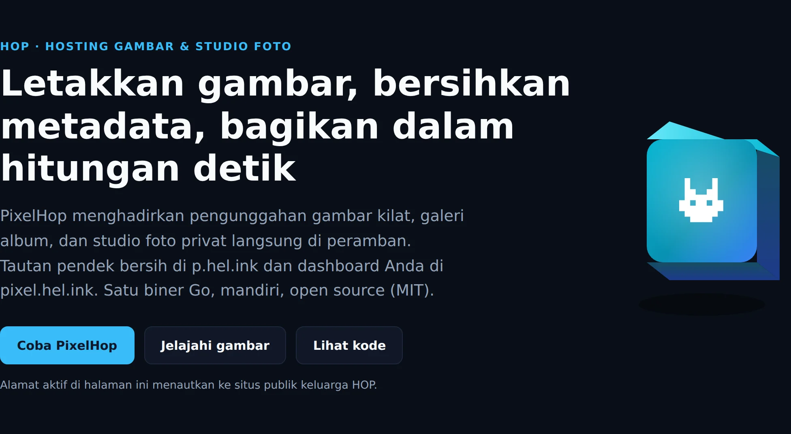
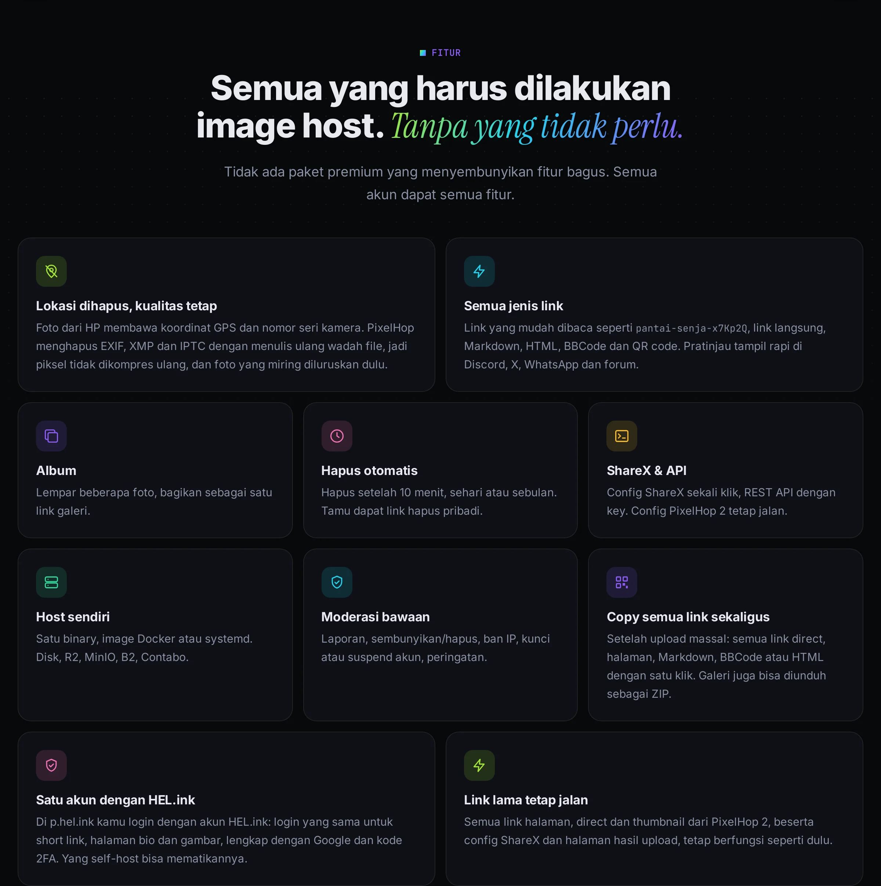
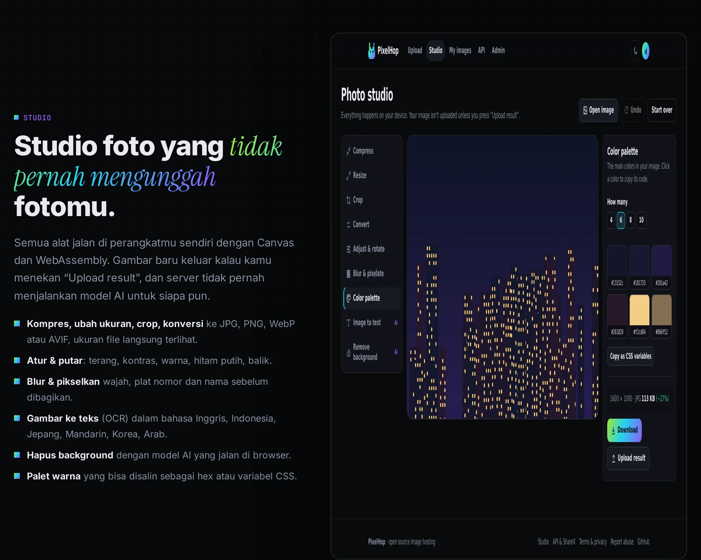

<p align="center"><a href="README.md">English</a> · <b>Bahasa Indonesia</b></p>

<p align="center"><picture><source media="(prefers-color-scheme: light)" srcset="docs/readme/hero-id-light.webp"></picture></p>

<p align="center">
  <b>Hosting gambar open source yang menghapus lokasi GPS sebelum ada yang melihatnya,<br>lengkap dengan studio foto yang tidak pernah mengunggah fotomu. Satu binary Go yang kecil.</b>
</p>

<p align="center">
  <a href="https://p.hel.ink"><b>🐰 Coba p.hel.ink</b></a> ·
  <a href="https://navi-crwn.github.io/pixelhop/?lang=id">Website</a> ·
  <a href="#instalasi">Instalasi</a> ·
  <a href="#api">API</a> ·
  <a href="#upgrade-dari-pixelhop-2">Upgrade dari v2</a> ·
  <a href="AUDIT.md">Audit</a> ·
  <a href="CHANGELOG.md">Changelog</a>
</p>

<p align="center">
  
  
  
  
</p>

---

## Apa itu PixelHop?

**Membagikan foto**
- Lempar, tempel atau beri link gambar, dan kamu langsung dapat link pendek yang mudah dibaca.
- Foto dari HP menyimpan lokasi GPS persis dan detail kamera. PixelHop **menghapus data tersembunyi itu** sebelum ada yang melihat, tanpa mengompres ulang gambarmu.
- Beberapa file sekaligus otomatis jadi **album**.

**Mengedit foto**
- **Studio** bawaan bisa mengompres, mengubah ukuran, crop dan konversi.
- Studio juga bisa blur wajah, membaca teks (OCR) dan menghapus background.
- Semuanya jalan **di browser**, jadi foto tetap di perangkatmu sampai kamu memilih mengunggahnya.

**Menjalankannya sendiri**
- PixelHop cuma satu program ~16 MB, dengan database di dalamnya.
- Salin ke server, jalankan, selesai. Tanpa PHP, Python, MySQL atau cron.

**Cocok untukmu kalau kamu:**
- sering berbagi screenshot dan foto di chat, forum, Discord atau GitHub;
- ingin tujuan ShareX yang kamu kendalikan sendiri;
- peduli dengan apa yang diceritakan fotomu.

<p align="center"><picture><source media="(prefers-color-scheme: light)" srcset="docs/readme/features-id-light.webp"></picture></p>

<p align="center"><picture><source media="(prefers-color-scheme: light)" srcset="docs/readme/studio-id-light.webp"></picture></p>

## Fitur

- **📍 Lokasi dihapus, kualitas tetap.**
  - EXIF, XMP dan IPTC dihapus dari JPEG, PNG dan WebP dengan menulis ulang wadah file, bukan meng-encode ulang piksel.
  - Foto HP yang miring diluruskan dulu.
- **🔗 Semua jenis link.**
  - ID mudah dibaca seperti `pantai-senja-x7Kp2Q`.
  - Link langsung, Markdown, HTML, BBCode dan QR code.
  - Tag Open Graph supaya pratinjau rapi di Discord, X dan WhatsApp.
- **🗂️ Album.** Unggah beberapa gambar, bagikan satu link galeri.
- **⏳ Hapus otomatis.** Setelah 10 menit, 1 jam, sehari, seminggu atau sebulan.
- **🙋 Tidak perlu akun.**
  - Tamu dapat link hapus pribadi untuk setiap gambar, juga diingat di browsernya.
  - Akun menambah galeri dengan pencarian, urutan, ganti nama, hapus massal dan kuota storage.
- **🎨 Studio foto.**
  - Di browser: kompres, ubah ukuran, crop, konversi (JPG, PNG, WebP, AVIF), atur & putar, blur & pikselkan, palet warna, **pembuat QR code**, **OCR** enam bahasa dan hapus background. Tidak ada yang diunggah kecuali kamu menekan *Upload result*.
  - Di server, untuk user yang login (opsional, [`tools/ai-server.py`](tools/ai-server.py)): **hapus background** sekitar 1 detik, **blur wajah otomatis**, **magic eraser** (LaMa) dan **HD upscale 2×** (Real-ESRGAN). Satu gambar per giliran, ada batas harian, tidak ada yang disimpan.
- **📦 Batch.** Ubah ukuran, konversi, hapus background, blur wajah atau upscale banyak gambar sekaligus, lalu unduh satu ZIP atau unggah jadi satu album.
- **🪪 Profil publik.** Nama, @username, foto, bio dan website. Halaman gambar dan album (beserta pratinjau link-nya) menampilkan siapa yang membagikan; `/u/username` hanya menampilkan gambar yang kamu pilih. Bisa dimatikan.
- **📋 Copy semua link.** Setelah upload massal, di album dan galeri: semua link direct, halaman, Markdown, BBCode atau HTML dengan satu klik.
- **👤 Satu akun dengan HEL.ink** (opsional). Isi `HELINK_URL` dan `HELINK_SSO_SECRET`, maka user login memakai akun [HEL.ink](https://hel.ink); daftar, password, Google dan 2FA diurus di sana.
- **🔌 API & ShareX.**
  - REST API dengan key `Bearer`.
  - Halaman settings membuat file `.sxcu` siap pakai untuk ShareX.
  - Config ShareX untuk PixelHop 2 tetap jalan.
- **🛡️ Moderasi.** Tombol report di setiap gambar, antrean laporan, sembunyikan/hapus, ban IP, kunci/suspend akun, popup peringatan, dan bar pengumuman.
- **🔐 Aman dari awal.**
  - Password Argon2id dan login Google.
  - Proteksi CSRF dan Content Security Policy yang ketat.
  - "Unggah dari link" yang kebal SSRF, pelindung decompression bomb, rate limit, dan penanganan IP yang paham proxy tepercaya.
  - API key dan token sesi disimpan dalam bentuk hash.
- **🏠 Bisa di-host sendiri.**
  - Satu binary statis, image Docker, atau unit systemd.
  - Simpan gambar di disk atau bucket S3 apa saja: AWS S3, Cloudflare R2, MinIO, Backblaze B2, Wasabi, Contabo.

## Instalasi

**Binary** (Linux, macOS, Windows; amd64 dan arm64 di halaman [Releases](../../releases)):

```bash
curl -L -o pixelhop https://github.com/navi-crwn/pixelhop/releases/latest/download/pixelhop-linux-amd64
chmod +x pixelhop
PIXELHOP_BASE_URL=https://img.contoh.com ./pixelhop
```

**Docker:**

```bash
docker run -d --name pixelhop -p 8080:8080 \
  -e PIXELHOP_BASE_URL=https://img.contoh.com \
  -v pixelhop:/data ghcr.io/navi-crwn/pixelhop:latest
```

**Dari source** (Go 1.27+):

```bash
git clone https://github.com/navi-crwn/pixelhop.git && cd pixelhop
make build && ./pixelhop
```

Buka `http://localhost:8080` lalu buat akun. **Akun pertama otomatis jadi admin.** Bisa juga lewat command line: `pixelhop user add kamu@contoh.com --admin`.

Semua pengaturan (environment variable, semuanya opsional) ada di [`.env.example`](.env.example). Contoh nginx dan systemd ada di folder [`deploy/`](deploy/).

## Cara pakai

1. Buka situsnya, lalu lempar, tempel (<kbd>Ctrl</kbd>+<kbd>V</kbd>) atau beri link gambar.
2. Opsional: pilih **Delete after**, dan apakah nama file ikut di link.
3. Link otomatis tersalin. Buka untuk melihat link langsung, kode embed dan QR code.

**ShareX:** buka **Settings → API keys**, buat key, lalu tekan **Download ShareX config with this key**. Klik dua kali filenya.

## API

```bash
curl -H "Authorization: Bearer ph_keymu" -F "file=@liburan.jpg" https://p.hel.ink/api/v1/upload
```

| Endpoint | Fungsi |
|---|---|
| `POST /api/v1/upload` | Unggah file (`file`, bisa berulang) atau link (`url`); opsi `expire`, `slug`, `album`, `title` |
| `GET /api/v1/images` | Gambar milikmu (`page`, `limit`, `q`, `sort`) |
| `GET` · `PATCH` · `DELETE /api/v1/images/{id}` | Lihat, ganti nama (`{"title": …}`) atau hapus |
| `GET /api/v1/me` | Akun dan pemakaian storage |
| `GET /api/v1/stats` | Total publik |

Dokumentasi lengkap ada di [`/docs`](https://p.hel.ink/docs) di setiap server PixelHop.

## Upgrade dari PixelHop 2

PixelHop 2 adalah aplikasi PHP dengan MySQL, Python venv dan cron. Kodenya disimpan di [`legacy/`](legacy/) dan tag [`v2.3.0-php`](../../tree/v2.3.0-php). Satu perintah memindahkan semuanya:

```bash
pixelhop import --images /var/www/pichost/data/images.json \
  --mysql "user:pass@tcp(127.0.0.1:3306)/pixelhop" --copy
```

- **User** tetap punya id, role, kuota dan **password** yang sama. Hash argon2id dari PHP tetap bisa dicek, lalu diperbarui saat login berikutnya. Akun Google tetap tersambung.
- **Gambar** tetap memakai id yang sama.
  - Dengan `--copy`, gambar diunduh ke storage PixelHop 3 dan thumbnail dibuat ulang.
  - Tanpa `--copy`, gambar disajikan dari bucket lama.
- **Link lama tetap jalan:**
  - `/{id}` dan `/i/2026/08/27/{id}_original.webp`;
  - `/auth/google-callback` (isi `GOOGLE_REDIRECT_URI`);
  - config ShareX yang mengirim ke `/api/upload.php`.

Kenapa ditulis ulang? Baca [AUDIT.md](AUDIT.md).

## Lisensi

- [MIT](LICENSE.md) © Ivan Novskies (navi-crwn). Komponen pihak ketiga ada di [CREDITS.md](CREDITS.md).
- Studio memuat [tesseract.js](https://github.com/naptha/tesseract.js) (Apache-2.0) dan [@imgly/background-removal](https://github.com/imgly/background-removal-js) (AGPL-3.0, tanpa modifikasi, dari jsDelivr) saat dibutuhkan.

Karya lain dari pembuat yang sama: [HEL.ink](https://github.com/navi-crwn/hel.ink) · [Amnesia](https://github.com/navi-crwn/amnesia).
