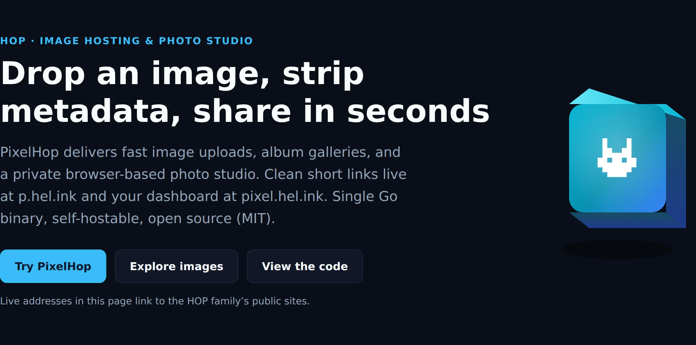
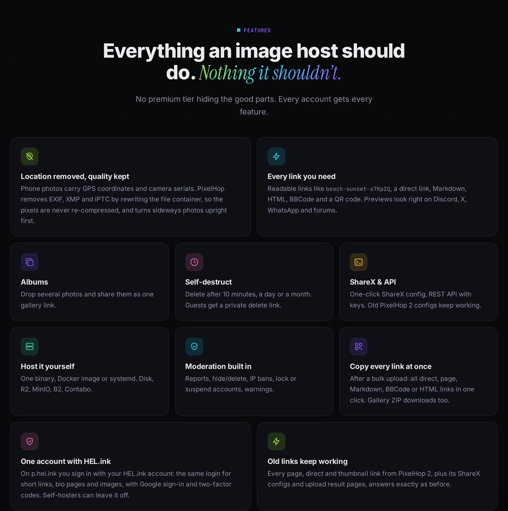
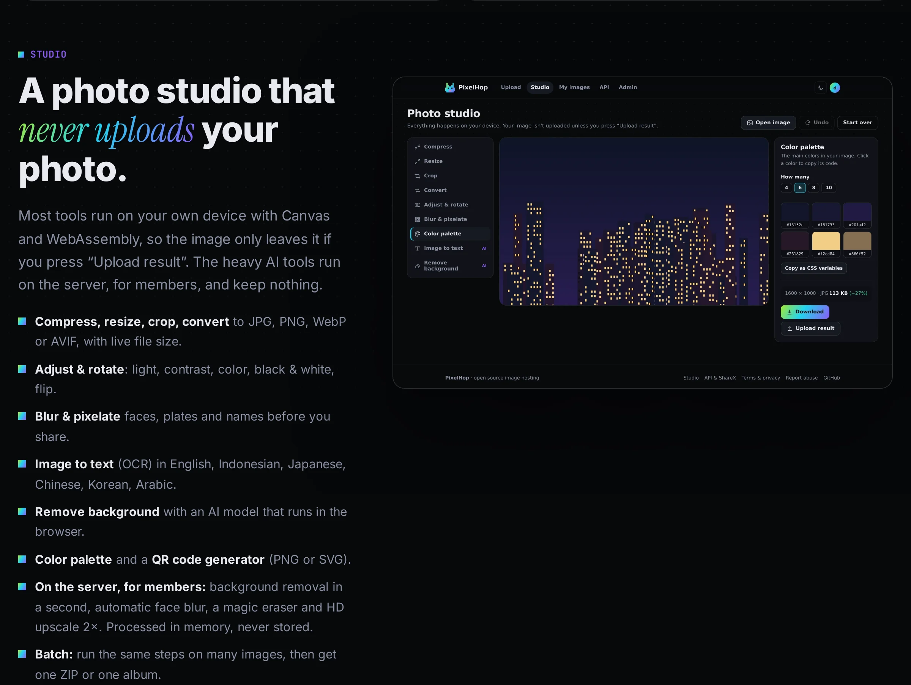

<p align="center">🌐 <b>English</b> · <a href="https://navi-crwn.github.io/pixelhop/zh-cn/">简体中文</a> · <a href="https://navi-crwn.github.io/pixelhop/de/">Deutsch</a> · <a href="https://navi-crwn.github.io/pixelhop/id/">Bahasa Indonesia</a> · <a href="https://navi-crwn.github.io/pixelhop/ja/">日本語</a> · <a href="https://navi-crwn.github.io/pixelhop/pt-br/">Português (Brasil)</a> · <a href="https://navi-crwn.github.io/pixelhop/es/">Español</a></p>

<p align="center"><picture><source media="(prefers-color-scheme: light)" srcset="docs/readme/hero-en-light.webp"></picture></p>

<p align="center">
  <b>Open-source image hosting that strips your GPS location before anyone sees it,<br>with a photo studio that never uploads your photo. One small Go binary.</b>
</p>

<p align="center">
  <a href="https://p.hel.ink"><b>🐰 Try p.hel.ink</b></a> ·
  <a href="https://navi-crwn.github.io/pixelhop/">Website</a> ·
  <a href="#install">Install</a> ·
  <a href="#api">API</a> ·
  <a href="#upgrading-from-pixelhop-2">Upgrade from v2</a> ·
  <a href="AUDIT.md">Audit</a> ·
  <a href="CHANGELOG.md">Changelog</a>
</p>

<p align="center">
  
  
  
  
  
</p>

---

## What is PixelHop?

**Sharing a photo**
- Drop, paste or link an image and you get a short, readable link.
- Photos taken on a phone carry their exact GPS location and camera details. PixelHop **removes that hidden data** before anyone can see it, without re-compressing your picture.
- Several files at once become an **album**.

**Editing a photo**
- The built-in **studio** compresses, resizes, crops and converts.
- It also blurs faces, reads text (OCR) and removes backgrounds.
- All of it runs **in your browser**, so the photo stays on your device until you choose to upload it.

**Running it yourself**
- PixelHop is a single ~16 MB program, with the database built in.
- Copy it to a server, start it, done. No PHP, Python, MySQL or cron jobs.

**Good for you if you:**
- share screenshots and photos on chats, forums, Discord or GitHub;
- want a ShareX destination you control;
- care about what your photos give away.

<p align="center"><picture><source media="(prefers-color-scheme: light)" srcset="docs/readme/features-en-light.webp"></picture></p>

<p align="center"><picture><source media="(prefers-color-scheme: light)" srcset="docs/readme/studio-en-light.webp"></picture></p>

## Features

- **📍 Location removed, quality kept.**
  - Strips EXIF, XMP and IPTC from JPEG, PNG and WebP by rewriting the file container, never re-encoding the pixels.
  - Sideways phone photos are turned upright first.
- **🔗 Every link you need.**
  - Readable ids like `beach-sunset-x7Kp2Q`.
  - A direct link, Markdown, HTML, BBCode and a QR code.
  - Open Graph tags so previews look right on Discord, X and WhatsApp.
- **🎬 Videos & PDFs too.** Screen recordings, phone videos and PDFs get a page, a preview and a link. Videos are stripped of their location and shrunk to 720p in the background; PDFs are compressed. Big files upload in resumable pieces.
- **🧾 Reports / tickets.** Give an upload a ticket number and a note, and get one link for everything plus a ready-to-paste list for WhatsApp or LINE.
- **🗂️ Albums.** Upload several images and share one gallery link. Edit the title, description, cover and order afterwards, or make an album from any selection.
- **🔒 Private or password-protected.** Per image: unlisted (default), only you, or behind a password. Locked files can't be hotlinked.
- **📈 View stats.** Views per day and the sites that link to your image, without tracking visitors.
- **📐 Resize on the fly.** `/i/photo.jpg?w=800&format=webp` makes and caches any size.
- **📱 Installable app.** Add PixelHop to your home screen and share photos to it from any app. iPhone HEIC photos are converted automatically.
- **⏳ Self-destruct.** Delete after 10 minutes, an hour, a day, a week or a month.
- **🙋 No account needed.**
  - Guests get a private delete link for every image, also remembered in their browser.
  - Accounts add a gallery with search, sorting, renaming, bulk delete and a storage quota.
- **🎨 Photo studio.**
  - In the browser: compress, resize, crop, convert (JPG, PNG, WebP, AVIF), adjust and rotate, blur & pixelate, color palette, **QR code generator**, **OCR** in six languages (tesseract.js) and background removal (@imgly). Nothing is uploaded unless you press *Upload result*.
  - On the server, for signed-in users (optional [`tools/ai-server.py`](tools/ai-server.py)): **background removal** in about a second (rembg), **automatic face blur** (OpenCV), **magic eraser** (LaMa) and **HD upscale 2×** (Real-ESRGAN). One image at a time, daily limits, nothing stored.
- **📦 Batch.** Resize, convert, watermark, remove backgrounds, blur faces or upscale a whole set, then download one ZIP or upload one album.
- **💧 Watermark & compare.** Put your name or logo on images, and hold a button to compare with the original.
- **🌍 Explore, oEmbed & sitemap.** A public feed of images people chose to show, embeds for WordPress/Discourse/Notion, and a gallery API for other sites.
- **🪪 Public profiles.** A name, @username, photo, bio and website. Image and album pages (and their link previews) say who shared them; `/u/username` shows only the images you pick. Can be switched off.
- **📋 Copy all links.** After a bulk upload, on albums and in your gallery: every direct link, page link, Markdown, BBCode or HTML in one click.
- **👤 Own accounts, or HEL.ink sign-in** (optional add-on). PixelHop has its own sign-up, passwords and Google sign-in and needs nothing else. Only if you also run [HEL.ink](https://github.com/navi-crwn/hel.ink) can you set `HELINK_URL` and `HELINK_SSO_SECRET` to let people use one account for both; leave them empty and PixelHop never contacts HEL.ink.
- **🔌 API & ShareX.**
  - A REST API with `Bearer` keys.
  - The settings page makes a ready-to-use `.sxcu` file for ShareX.
  - ShareX configs made for PixelHop 2 keep working.
  - Signed webhooks when you upload or delete.
  - A command-line uploader in the same binary: `pixelhop push *.png --format markdown`.
- **🛡️ Moderation.** A report button on every image, a report queue, hide/delete, IP bans, account lock/suspend, warning pop-ups, and an announcement bar.
- **🔐 Safe by default.**
  - Argon2id passwords and Google sign-in.
  - CSRF protection and a strict Content Security Policy.
  - SSRF-proof "upload from link", a decompression-bomb guard, rate limits, and trusted-proxy-aware IP handling.
  - Hashed API keys and session tokens.
- **🏠 Self-hostable.**
  - One static binary, a Docker image, or a systemd unit.
  - Store images on disk or any S3-compatible bucket: AWS S3, Cloudflare R2, MinIO, Backblaze B2, Wasabi, Contabo.

## Install

**Binary** (Linux, macOS, Windows; amd64 and arm64 on the [Releases](../../releases) page):

```bash
curl -L -o pixelhop https://github.com/navi-crwn/pixelhop/releases/latest/download/pixelhop-linux-amd64
chmod +x pixelhop
PIXELHOP_BASE_URL=https://img.example.com ./pixelhop
```

**Docker:**

```bash
docker run -d --name pixelhop -p 8080:8080 \
  -e PIXELHOP_BASE_URL=https://img.example.com \
  -v pixelhop:/data ghcr.io/navi-crwn/pixelhop:latest
```

**From source** (Go 1.27+):

```bash
git clone https://github.com/navi-crwn/pixelhop.git && cd pixelhop
make build && ./pixelhop
```

Open `http://localhost:8080` and create an account. **The first account becomes the admin.** You can also make one from the command line: `pixelhop user add you@example.com --admin`.

<details>
<summary><b>Settings</b> (environment variables; all optional)</summary>

Everything is in [`.env.example`](.env.example). The ones you're most likely to change:

| Variable | Default | What it does |
|---|---|---|
| `PIXELHOP_BASE_URL` | `http://localhost:8080` | Public address, used in every link |
| `PIXELHOP_DATA` | `./data` | Database and (local) images |
| `PIXELHOP_MAX_UPLOAD_MB` | `20` | Per image |
| `PIXELHOP_MAX_MEDIA_MB` | `100` | Per video or PDF, for signed-in members |
| `PIXELHOP_GUEST_MAX_MB` | `20` | Per file of any kind, for guests |
| `PIXELHOP_GUEST_UPLOADS` | `true` | Allow uploads without an account (also a switch in Admin) |
| `PIXELHOP_TRUSTED_PROXIES` | — | `cloudflare`, or IPs/CIDRs of your reverse proxy |
| `PIXELHOP_STORAGE` | `local` | `local` or `s3` |
| `S3_ENDPOINT`, `S3_BUCKET`, `S3_ACCESS_KEY`, `S3_SECRET_KEY` | — | For S3-compatible storage |
| `S3_PUBLIC_URL` | — | CDN address of the bucket; image links redirect there |
| `GOOGLE_CLIENT_ID`, `GOOGLE_CLIENT_SECRET` | — | "Sign in with Google" |
| `HELINK_URL`, `HELINK_SSO_SECRET` | — | Sign in with a HEL.ink account (same secret as HEL.ink's `PIXELHOP_SSO_SECRET`) |
| `HELINK_API_ADDR` | — | Optional `host:port` to reach HEL.ink directly (e.g. `127.0.0.1:443` on the same server) for password checks |
| `TURNSTILE_SITE_KEY`, `TURNSTILE_SECRET_KEY` | — | Cloudflare Turnstile on sign-in and sign-up |
| `PIXELHOP_REMBG_URL` | — | Address of `tools/ai-server.py`, e.g. `http://127.0.0.1:7001`, to turn on the server AI tools |
| `PIXELHOP_INACTIVE_DAYS` | `0` | Delete images nobody viewed for N days |

</details>

<details>
<summary><b>Behind nginx / Cloudflare, and as a service</b></summary>

- [`deploy/nginx.conf`](deploy/nginx.conf) is a reverse-proxy example. Set `PIXELHOP_TRUSTED_PROXIES=127.0.0.1` so PixelHop believes nginx's `X-Forwarded-For`; add `cloudflare` if Cloudflare is in front.
- [`deploy/pixelhop.service`](deploy/pixelhop.service) is a hardened systemd unit; [`deploy/pixelhop-ai.service`](deploy/pixelhop-ai.service) runs the optional AI tools (`pip install "rembg[cpu]" opencv-python-headless onnxruntime`, plus the LaMa and Real-ESRGAN x2plus ONNX files).
- Back up by copying the data folder (or `sqlite3 data/pixelhop.db ".backup copy.db"` while it runs).

</details>

## How to use it

1. Open the site, then drop, paste (<kbd>Ctrl</kbd>+<kbd>V</kbd>) or link an image.
2. Optional: pick **Delete after**, and whether the file name goes in the link.
3. The link is copied for you. Open it for the direct link, embed codes and QR code.

**ShareX:** go to **Settings → API keys**, create a key, then press **Download ShareX config with this key**. Double-click the file.

**Command line:** the same `pixelhop` binary uploads to any PixelHop server.

```bash
pixelhop login --server https://p.hel.ink --key ph_yourkey
pixelhop push screenshot.png photos/*.jpg --expire 7d --format markdown
```

**Phone:** open the site, choose **Add to Home Screen**, and PixelHop appears in your share sheet.

## API

```bash
curl -H "Authorization: Bearer ph_yourkey" -F "file=@holiday.jpg" https://p.hel.ink/api/v1/upload
```

| Endpoint | What it does |
|---|---|
| `POST /api/v1/upload` | Upload files (`file`, repeatable) or links (`url`); options `expire`, `slug`, `album`, `title` |
| `GET /api/v1/images` | Your images (`page`, `limit`, `q`, `sort`) |
| `GET` · `PATCH` · `DELETE /api/v1/images/{id}` | Read, rename (`{"title": …}`), show on your profile (`{"listed": true}`) or delete one |
| `PATCH /api/v1/images/{id}` | Also `alt` and `visibility` (`unlisted`, `private`, `password` + `password`) |
| `GET /api/v1/images/{id}/stats` | Views per day and referring sites |
| `GET` · `POST /api/v1/albums`, `GET` · `PATCH` · `DELETE /api/v1/albums/{id}` | List, create, edit (title, description, cover, order, add, remove) and delete albums |
| `GET /api/v1/users/{username}/images` | Public: someone's profile images |
| `GET /oembed?url=…` | oEmbed for image pages |
| `GET /i/{id}.jpg?w=&h=&fit=&format=&q=` | Resized copies, made once and cached |
| `GET /api/v1/me` | Your account and storage use |
| `GET /api/v1/stats` | Public totals |
| `POST /api/v1/tools/{remove-background,faces,erase,upscale}` | Server AI tools (signed in; `file`, plus `mask` for erase) |
| `GET /tools/qr.png` · `/tools/qr.svg` | QR code for `text` (`size`, `level`, `fg`, `bg`) |

Every answer looks like `{"success": true, "data": …}` or `{"success": false, "error": "…"}`. The full reference is at [`/docs`](https://p.hel.ink/docs) on any PixelHop server.

## Upgrading from PixelHop 2

PixelHop 2 was a PHP app with MySQL, a Python venv and cron jobs; its code lives on in the [`v2.3.0-php`](../../tree/v2.3.0-php) tag. One command brings everything over:

```bash
pixelhop import --images /var/www/pichost/data/images.json \
  --mysql "user:pass@tcp(127.0.0.1:3306)/pixelhop" --copy
```

- **Users** keep their ids, roles, quotas and **passwords** (PHP's argon2id hashes are verified and upgraded on next sign-in). Google accounts stay linked.
- **Images** keep their ids. With `--copy` they are downloaded into PixelHop 3's storage with fresh thumbnails; without it they are served from the old buckets.
- **Links keep working:** `/{id}`, `/i/2026/08/27/{id}_original.webp`, `/auth/google-callback` (set `GOOGLE_REDIRECT_URI`), and ShareX configs posting to `/api/upload.php`.

Why the rewrite? Read [AUDIT.md](AUDIT.md).

## Project layout

```
cmd/pixelhop/     the command: serve, user, import
internal/app/     web server: pages, API, uploads, admin
internal/db/      SQLite schema, migrations and queries
internal/imaging/ type sniffing, metadata stripping, thumbnails
internal/storage/ local disk, S3 (own SigV4 signer), legacy URLs
internal/netsafe/ SSRF-safe fetching for "upload from link"
web/              templates and static files, embedded in the binary
docs/             the GitHub Pages website and README images
```

`make test` runs the tests; `npm run readme-images` re-renders the README pictures from the website.

## FAQ

<details><summary><b>Is the studio really private?</b></summary>

Yes. Editing happens on your device with Canvas and WebAssembly. The first time you use OCR or background removal, the browser downloads the open-source models from jsDelivr. Your image is not sent anywhere unless you press *Upload result*.
</details>

<details><summary><b>Can I turn off guest uploads or sign-ups?</b></summary>

Yes, both are switches in **Admin → Settings**.
</details>

<details><summary><b>How much does it need?</b></summary>

PixelHop runs on a 512 MB VPS or a Raspberry Pi. It uses a few tens of MB of memory at rest. Big uploads are decoded a few at a time, so bursts can't exhaust memory.
</details>

## Credits & license

- [MIT](LICENSE.md) © Ivan Novskies (navi-crwn). Third-party parts are listed in [CREDITS.md](CREDITS.md).
- Built with [Go](https://go.dev), [modernc.org/sqlite](https://gitlab.com/cznic/sqlite), [golang.org/x/image](https://pkg.go.dev/golang.org/x/image) and [rsc.io/qr](https://pkg.go.dev/rsc.io/qr).
- The studio loads [tesseract.js](https://github.com/naptha/tesseract.js) (Apache-2.0) and [@imgly/background-removal](https://github.com/imgly/background-removal-js) (AGPL-3.0, unmodified, from jsDelivr) on demand.

More by the same author: [HEL.ink](https://github.com/navi-crwn/hel.ink) (link shortener & link in bio) · [Amnesia](https://github.com/navi-crwn/amnesia) (a Mac that forgets at logout).
