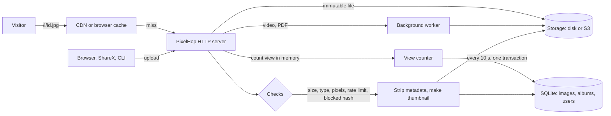

# How PixelHop works

One static Go binary and one SQLite file. This page is the map: what runs, what is stored where, and why it stays fast and steady under load.

## What happens on upload

1. **Admission.** Size, type (by the file's own header, not its name), pixel count (a 1 MB PNG that decodes to 50 000 × 50 000 pixels is refused before it is decoded), per-address rate limit, free disk space, and the list of files that were taken down before (by SHA-256).
2. **Processing.** Location and camera data are removed from JPEG, PNG and WebP files by rewriting the container, so the compressed picture data is copied unchanged. The exception is a JPEG with an EXIF rotation: it is turned upright and saved again at quality 92. GIFs are stored as uploaded. A thumbnail and a dominant colour (the placeholder shown while the image loads) are made.
3. **Storage.** The file goes to disk or any S3-compatible bucket under a name that never changes, so it can be cached for a year (`Cache-Control: immutable`).
4. **Heavy work leaves the request.** Videos are stripped of metadata without re-encoding when `ffmpeg` is installed, then shrunk by a background worker with limited concurrency, so a burst of uploads cannot exhaust memory. PDFs are compressed with Ghostscript when `gs` is installed and keep their document properties. Without those tools the files are stored as uploaded. The link works at once.

## What happens on a view

- A direct file is served with long cache headers; behind a CDN almost no visit reaches the server.
- Views are **counted in memory** and written together every ten seconds in one transaction, so a viral image costs one write per flush instead of three per visitor. A crash loses at most the last few seconds of counts.
- Referrers are stored by host name only, and no visitor profile is kept.

## Keeping it steady

| Risk | What PixelHop does |
|---|---|
| Out of memory on many uploads | Admission is serial and sized against free space; media jobs run in one background worker |
| Decompression bombs | Pixel limit read from the header before decoding (`PIXELHOP_MAX_MEGAPIXELS`) |
| Disk full | Uploads pause by themselves; files already online keep working |
| Maintenance or upgrade | `PIXELHOP_READ_ONLY=true` (or the control center) pauses uploads only |
| A key leaks | Keys can be limited to **Upload only**; they are stored hashed |
| Other sites eating bandwidth | Owners can refuse embedding on other websites; `Vary: Referer` keeps a CDN honest |
| Abuse | Report button; the queue, IP bans and takedowns (which also block the file's hash) run in the HOP control center through the signed `/hop/*` API |
| Monitoring | `/healthz`, Prometheus `/metrics`, `/status` page |

## Where things are

| Path | What |
|---|---|
| `cmd/pixelhop` | The binary: server, CLI uploader (`push`), admin commands |
| `internal/app` | HTTP handlers, upload pipeline, moderation, HOP App Protocol |
| `internal/db` | SQLite schema, migrations, queries, the view counter |
| `internal/imaging` | Metadata stripping, thumbnails |
| `internal/storage` | Disk and S3 back ends |
| `web/templates`, `web/static`, `web/i18n` | Pages, scripts, the nine languages (embedded in the binary) |
| `tools/ai-server.py` | Optional server-side AI tools (background removal, upscale, …) |

## Running it

See the [README](../README.md#install) for the one-command installer, Docker and systemd. Put nginx or Caddy in front for HTTPS (`deploy/nginx.conf`), set `PIXELHOP_TRUSTED_PROXIES`, and, if you like, serve the files from a separate cookie-less host with `PIXELHOP_LINK_URL`.
